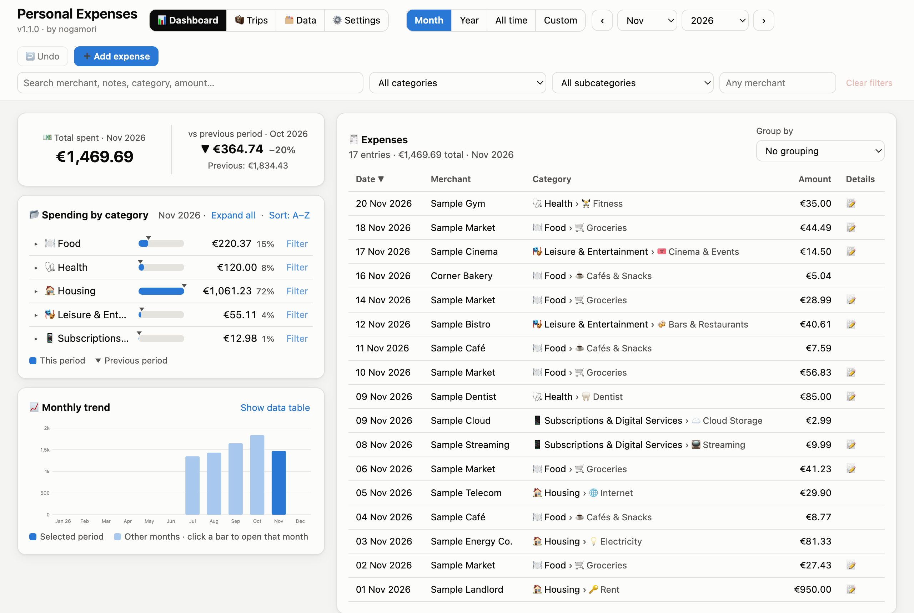
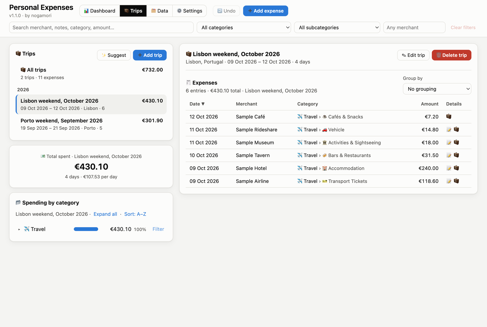
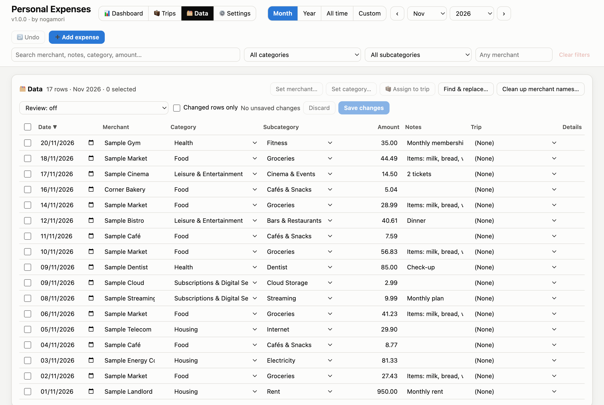
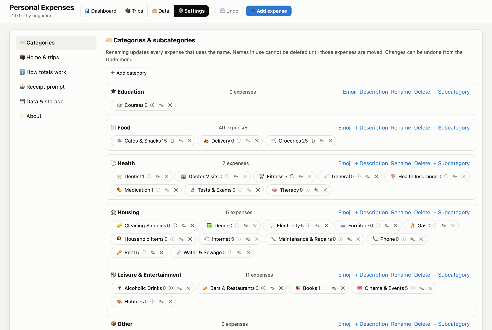
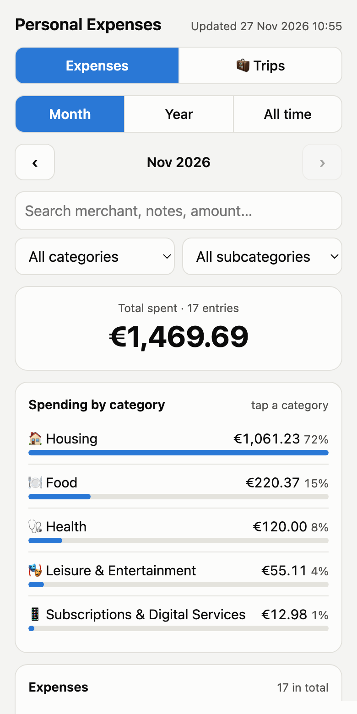
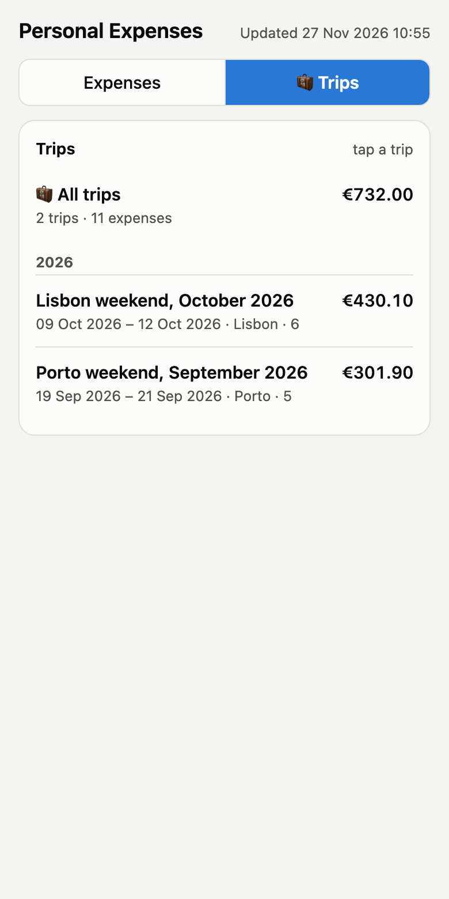
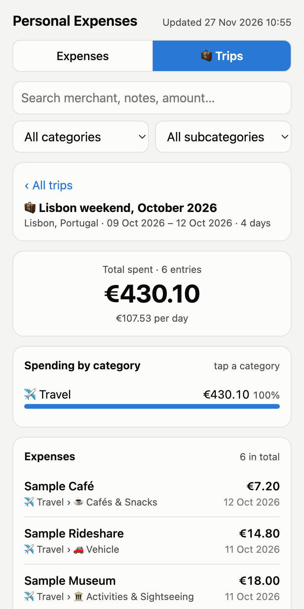
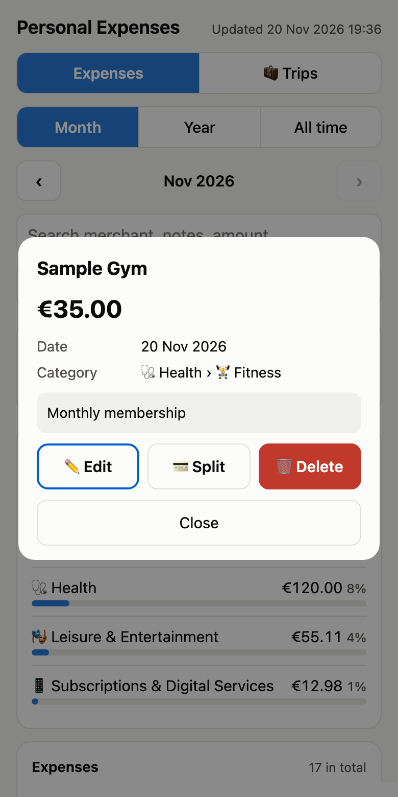

# Personal Expenses

A local-first dashboard for personal expenses. Your data lives in one file, `data/expenses.json`, in this project folder, on the computer that runs the server; nothing is stored in the cloud.
The dashboard needs Python 3.9 or newer and nothing else to install (no packages, no accounts, no internet; tested on Python 3.9 and 3.14). It runs on **Windows, macOS and Linux**, and its phone page works on **iPhone, iPad and Android**.

## Screenshots
All the data below is made up (`examples/sample-data.json`).

**Dashboard**: totals, comparison with the previous period, spending by category, the monthly trend and the list of expenses.


**Trips**: pick a trip and see its total, cost per day, categories and expenses.


**Data**: a spreadsheet-style grid for quick edits in bulk.


**Settings**: categories, subcategories, emojis, descriptions, home city and the receipt prompt.


**On the phone**: a read-only page with all your data. Month view, trips, one trip and an expense's details (edit, split, delete).

<p>




</p>

## Start and stop
Install [Python 3](https://www.python.org/downloads/) if you do not have it (macOS and most Linux systems already include it). Then start the server in whichever way suits your system:

| System | How |
|---|---|
| **Windows** | Double-click `Start Expenses.bat`. If Windows warns about an unknown file, choose *More info › Run anyway*. |
| **macOS** | Double-click `Start Expenses.command` (the first time: right-click › Open). |
| **Linux** | Run `./start-expenses.sh` in a terminal. |
| **Any system** | In this folder run `python3 server.py` (`python server.py` on Windows; `--port 9000` changes the port), then open http://127.0.0.1:8765. |

The launchers open the dashboard in your browser. Close the window (or press **Ctrl+C**) to stop. The server listens on `127.0.0.1`, so only the computer that runs it can open the dashboard; other devices reach your data only through the phone page below. After updating the code, stop and start the server again. Keyboard shortcuts below use **Cmd** on macOS and **Ctrl** on Windows and Linux.

### Starting with your own data
The first run creates `data/expenses.json` from `examples/sample-data.json`, so you can look around. To start empty instead, stop the server, delete `data/expenses.json` and start it with `python3 server.py --empty` (it keeps the categories and removes the sample expenses and trip). Add your categories and your home city in *Settings*, then add expenses by hand or through the inbox.

## What it does
- **Dashboard:** pick a month, year, all time or a custom range; search and filter by category, subcategory and merchant. See total spent with a comparison to the previous period, spending by category (expandable to subcategories), a monthly trend, scheduled (future-dated) payments and the list of expenses, which you can group.
- **Add, edit and delete** expenses, with validation and a duplicate warning. Attach a receipt (image or PDF); it opens in a window over the page (Cmd/Ctrl-click opens a new tab).
- **Data tab:** a spreadsheet-style grid. Edit cells, select rows (Shift-click for a range) and use *Set merchant*, *Set category*, *Find & replace* or *Clean up merchant names*. Nothing is saved until *Save changes*.
- **Installments:** open an expense and choose *Split into installments…*. An installment's drawer has *Edit plan* (number, dates and amounts), *Merge installments* and *Delete all installments*; a single installment cannot be deleted on its own.
- **Receipts and the phone (iPhone, iPad, Android):** an automation of your choice reads receipts into `Inbox/`, and a page (`Mobile/expenses.html`) can edit, split and delete from the phone. See *Capturing receipts*, *The inbox*, *Edit from the phone* and *Mobile view* below.
- **Undo:** the **↩️ Undo** menu lists the last 10 saved actions; choosing one undoes it and everything above it, and an undo can itself be undone. `⌘Z` / `Ctrl+Z` undoes the latest action.
- **Trips:** the **🧳 Trips** tab is the Dashboard limited to trips: pick a trip on the left (or none, for every trip) and use the same filters, totals, categories and table, with cost per day. Add, edit and delete trips there; set your home city in Settings. Expenses are assigned to a trip (🧳) without changing their category, and the 🧳 of an expense opens its trip. The Data tab can review expenses dated inside a trip but not assigned.
- **Reload (Cmd/Ctrl+R):** the page keeps the tab, filters, grouping and selected trip of that browser tab.
- **⚙️ Settings:** categories (add, rename, delete, descriptions, emojis), home city, *How totals work*, the receipt prompt (rules, copy, preview), data and storage information with an integrity check, and *About* (version and changelog).

## Folder map
```
Start Expenses.bat       double-click to start (Windows)
Start Expenses.command   double-click to start (macOS)
start-expenses.sh        start from a terminal (Linux, macOS)
examples/                sample-data.json, used on the first run
docs/screenshots/        the pictures in this README
server.py                the local server (Python standard library only)
public/                  the dashboard: index.html, styles.css, app.js, data-view.js, settings.js, trips.js
data/
  expenses.json          your data (the source of truth)
  receipt-prompt.md      receipt prompt for your phone automation, generated automatically
  history.json           the undo history
  applied-edits.json     ids of the phone requests already applied
  backups/               a compressed copy (.json.gz) of the data before every change
Receipts/                receipt files linked to expenses
Inbox/                   files left by your phone automation (Processed/, Failed/ after import)
prompts/                 receipt-prompt.template.md (the prompt wording)
templates/               mobile.template.html (the phone page)
Mobile/                  expenses.html, generated for the phone
scripts/validate.py      integrity checks of the data: python3 scripts/validate.py
scripts/test.py          tests of the server, on a temporary copy: python3 scripts/test.py
VERSION  CHANGELOG.md    current version and what changed
```

## How data is saved
Every change goes through the server, which:
1. validates the data and refuses invalid changes with a clear message;
2. rejects changes made on an out-of-date page (revision check), so nothing is overwritten silently;
3. copies the previous file, compressed, to `data/backups/expenses-<time>-r<revision>.json.gz` (the newest 30 are kept, plus any the undo history still needs);
4. writes the new file atomically (temporary file, then rename).

Fields the dashboard does not know about are preserved when an expense is edited. To recover manually, stop the server, unzip a file from `data/backups/` (`gunzip -k <file>.json.gz`) and copy the result over `data/expenses.json`.

## Receipts
In the add/edit form you can attach a JPG, PNG, WEBP, GIF, HEIC or PDF, up to 25 MB. The server checks the file content, saves it as `Receipts/YYYYMMDD_HHMMSS.<ext>` and links it to the expense. Removing a receipt in the form only unlinks it; the file stays in `Receipts/`.

## Capturing receipts with your phone (suggested setup)
The server does not read receipts itself. It imports what lands in `Inbox/`, so any app on any phone that can save two files into this folder works. The idea:

1. **Take or share the receipt** (photo, image or PDF) with an app on your phone.
2. **Ask an AI model to read it.** Send the document together with `data/receipt-prompt.md` (the server builds it from your categories, trips and home city). The model replies with one JSON object.
3. **Save two files in this folder:** the receipt as `Receipts/<receiptId>.<ext>` and the model's reply as `Inbox/<receiptId>.txt` (or `.json`). `receiptId` is the moment of the scan, `YYYYMMDD_HHMMSS`. The server imports the entry within about 20 seconds, links the receipt, skips duplicates and moves the file to `Inbox/Processed/` (or `Inbox/Failed/` with an explanation).

The phone has to reach the project folder of the computer that runs the server. Keep the folder in a synced one (iCloud Drive, Google Drive, Dropbox, OneDrive, Syncthing…) or copy the two files over yourself. The server must be running on that computer for the files to be imported; anything left in `Inbox/` while it is off is imported the next time it starts.

Pick the combination that fits your phone and the AI you prefer; they are all equivalent for the server:

| | iPhone / iPad | Android |
|---|---|---|
| **Automation** | A **Shortcut** that appears in the Share Sheet. | An automation app such as **Tasker**, **MacroDroid** or **HTTP Shortcuts**, set to receive shared files. |
| **AI that reads the receipt** | The **Use Model** action (Apple Intelligence, including *Private Cloud Compute*), or a third-party model such as ChatGPT or Claude through its Shortcuts action. | **Gemini** (the app or the Gemini API), or any other model through its API. |
| **Saving the files** | The Shortcut's **Save File** action into the synced folder. | The automation app writes the files into the synced folder. |

A third way works on **any** phone and any computer: a small script or automation that calls the API of OpenAI, Anthropic, Google or a local model, sending the prompt and the image, and writes the files above. Without a phone at all: copy the photo into `Receipts/`, paste the prompt and the photo into any chat assistant, and save its reply into `Inbox/`.

The JSON the model returns is checked before it is imported: dates, amounts, currencies and category names are normalised, card numbers are masked, and anything the server cannot place goes to *Other › Unclassified* with a note. A model can make mistakes, so look at the new entries now and then; the Data tab's review tools and *Undo* are there for that.

## Receipt prompt
`prompts/receipt-prompt.template.md` holds the wording. `data/receipt-prompt.md` is built from it, from your categories (with their descriptions), the prompt rules, your home city and your trips, and is regenerated whenever the server starts or categories change. Your automation should read the generated file; edit the template, never the generated file.

## The inbox
Whatever captures the receipts never edits `data/expenses.json`: it saves the receipt as `Receipts/<receiptId>.<ext>` and the model's JSON reply as `Inbox/<receiptId>.txt` (some automation tools can only save `.txt`; `.json` is accepted too). While the server runs it imports new inbox files every ~20 seconds (*Settings › Data & storage › Import now* does it at once), then moves them to `Inbox/Processed/`; files it cannot read go to `Inbox/Failed/` with a `.error.txt`. Imports can be undone like any other change.

## Edit from the phone
In the mobile page an expense's details have **Edit**, **Split** and **Delete**. The page cannot write files, so the change travels as a small JSON request that must end up in `Inbox/`; the server applies it within about 20 seconds (it must be running):
- **iPhone and iPad:** the page calls a Shortcut named `Expenses Mobile` (`SHORTCUT_NAME` in the template), which saves the request text as `Inbox/edit_<editId>.txt`.
- **Android and other browsers:** the page opens the share sheet (or downloads) a file `edit_<editId>.txt`. Save it into `Inbox/`, or let a sync app or automation move it there.
- **Your own automation:** set `EDIT_URL_TEMPLATE` in the template to a link that your automation app handles, with `{text}` (the request) and `{name}` in it.

A request is `{"kind":"expense-edit","editId","action":"edit|delete|split|delete-plan","expenseId","base", ...}`; `base` is the expense's `updatedAt` on the page, and the server refuses the change if the expense changed since. Applied `editId`s are kept in `data/applied-edits.json`.

## Mobile view
`Mobile/expenses.html` is regenerated by the server at start and after every change. It is a page with all the data inside it, so it needs no server or internet on the phone. The **🧳 Trips** switch at the top lists your trips; tap one to see its total, cost per day, categories and expenses. The template is `templates/mobile.template.html`.

Getting the page onto the phone and opening it:
- **Android:** put the project folder (or just `Mobile/expenses.html`) in a synced folder, open the file from your file manager or Drive and choose Chrome (or another browser). **Open receipt** opens `Receipts/<file>` next to it, so receipts open when the page is opened from inside the synced project folder.
- **iPhone and iPad:** the Files app previews the page without running scripts, so open it from a Shortcut: **Get File** `Mobile/expenses.html` → **Base64 Encode** (line breaks: none) → **Text** `data:text/html;base64,` + the encoded text → **Open URLs**. **Open receipt** runs a second Shortcut called *Open Receipt* (`RECEIPT_SHORTCUT` in the template): it gets the file from `Receipts` by name and opens it in Safari (a JPEG as a `data:image/jpeg` URL; a PDF through a small page that draws its pages with PDF.js from cdnjs, so PDFs need internet, because Safari on iPhone cannot show a `data:` PDF).
- **Any computer:** just open `Mobile/expenses.html` in a browser.

## Checks and tests
- `python3 scripts/validate.py` checks your data (format, unique ids, receipt files, card numbers, category names). The same checks run from *Settings › Data & storage*.
- `python3 scripts/test.py` runs 45 tests of the server on a **temporary copy** (your data, receipts and inbox are never touched): validation, the inbox, edits from the phone, installments, undo, backups and restoring one, and the security rules below. It takes under a minute.

## Security
The server listens on `127.0.0.1` only and refuses requests with another `Host`, another `Origin` or no app header; receipt files are served only from inside `Receipts/`; the phone can change only a fixed list of fields (never the receipt file), a phone request is applied only if the expense has not changed since the page was built, and an inbox file larger than 1 MB is refused unread. The data stays on the computer that runs the server, except for what your phone automation sends to the AI model you chose, and whatever sync service you keep the project folder in. Note that `Mobile/expenses.html` holds a copy of all your expenses, so treat it, and the synced folder, as private.

## Versioning
The app follows [Semantic Versioning](https://semver.org/) and reached **1.0.0** after a beta (`0.9.0-beta.N`) and a release candidate (`1.0.0-rc.N`) phase: MAJOR for breaking data or API changes, MINOR for new features, PATCH for fixes. The current version is in `VERSION` and shown in the page header; `CHANGELOG.md` lists what changed. The data format has its own `schemaVersion` inside `expenses.json`.

## Notes
- Dates are stored as `YYYY-MM-DD` and shown as `15 Mar 2026`. Receipt IDs for new receipts use `YYYYMMDD_HHMMSS`.
- Notes are free text. The receipt prompt asks the model to write them in English; change the template if you prefer another language.
- Currencies are never added together and no exchange rates are used.
